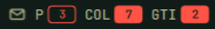
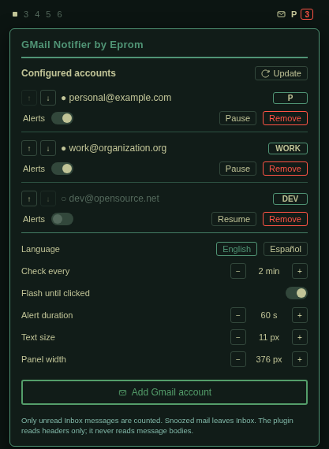

# Gmail Notifier by Eprom

A lightweight personal Omarchy bar widget that checks multiple Gmail accounts without depending on a browser profile or container. The bar always has one envelope button for settings; account badges appear only while that account has unread Inbox messages.

### Bar notifications screenshot

<p align="center">
  
</p>

### Widget settings panel screenshot

<p align="center">
  
</p>

## Features

- One account badge per account with unread messages. The user chooses a one-to-seven-character label and can reorder accounts.
- Clicking an account badge shows sender and subject for all unread Inbox messages. The plugin never reads message bodies and has no mail actions. Clicking an account stops any active new-mail flashing immediately.
- Header includes a manual **Update** button to immediately query Gmail on demand.
- Account headings and separators follow Omarchy's live popup-border color. Sender display names use the theme accent, without bold; subjects use the normal theme foreground.
- Themed styling with dynamic Omarchy tokens: "Add Gmail account" button uses the active theme's green (`themeGreen` from `colors.toml` / `Color.accent`) with a 2 px thick border; "Remove" and confirmation use urgent red (`themeRed` from `Color.urgent` / `colors.toml`).
- Cleaner two-line layout per account: top line has reorder arrows (`↑` and `↓`), status dot, email address, and label field; bottom line has desktop alerts toggle (`Ui.ToggleSwitch`), pause/resume button, and remove button.
- Desktop notifications ("Alerts") send `notify-send` alerts to Omarchy's notification server and can be toggled per account.
- Flash duration is configurable in seconds (default: 60s, range 5s–600s), with a toggle for "Flash until clicked".
- Messages outside Inbox, including snoozed mail, are excluded.
- Accounts can be paused, resumed, silenced, or removed. Polling is adjustable from 1 to 60 minutes (2 minutes by default).
- Settings support Spanish and English, use compact theme-styled buttons, and require an explicit confirmation before removing an account. The account label field has a visible outline. The panel starts at 376 px and can be resized in settings.
- All monitors share alert generations and acknowledgements: clicking an account stops that alert everywhere. Local file watches propagate changes, with a five-second local-state fallback even when every account is paused. A process lock/cache ensures periodic Gmail polling happens only once per configured interval.
- Google OAuth runs in the system default browser with PKCE and a loopback callback. Chrome/Chromium is not required; Zen Browser works when it is the default browser.

## Installation

Install directly in Omarchy using the official CLI:

```bash
omarchy plugin add https://github.com/eprompc/omarchy-gmail-notifier.git --enable --yes
```

To update to the latest release at any time:

```bash
omarchy plugin update eprom.gmail-notifier
```

### Uninstall

To disable and remove the plugin from Omarchy:

```bash
omarchy plugin disable eprom.gmail-notifier
omarchy plugin remove eprom.gmail-notifier
```

Requirements: Omarchy, `python3`, `secret-tool` (from `libsecret`), `notify-send` (from `libnotify`), and a working Secret Service in the desktop session.

### Omarchy 4.5 compatibility

The plugin uses Omarchy's schema 1 `bar-widget` contract and is compatible with Omarchy 4.5 (Quattro). Validate a checkout before enabling it:

```bash
omarchy plugin validate .
python3 -m unittest discover -s tests -v
node --test tests/model.test.cjs tests/manifest.test.cjs
python3 -m compileall -q helper
```

The widget keeps Gmail polling and alert acknowledgements in shared local files so separate bar instances can converge across monitors. Account pausing disables that account's polling and notifications.

## Google OAuth setup

The plugin reads a Google Desktop OAuth client configuration from:

```text
~/.config/omarchy/gmail-notifier/oauth-client.json
```

### Creating your OAuth client

1. In the [Google Cloud Console](https://console.cloud.google.com/), create a project and enable the **Gmail API**.
2. Configure the **OAuth consent screen** (External, add test user emails if in Testing mode). The app requests only the `https://www.googleapis.com/auth/gmail.metadata` scope.
3. Under **Credentials**, create an OAuth client ID with application type **Desktop app**.
4. Download the JSON or format it as follows:

```json
{
  "installed": {
    "client_id": "YOUR_CLIENT_ID.apps.googleusercontent.com",
    "client_secret": "YOUR_CLIENT_SECRET"
  }
}
```

5. Save it to `~/.config/omarchy/gmail-notifier/oauth-client.json` with permissions `600`:

```bash
mkdir -p -m 700 ~/.config/omarchy/gmail-notifier
chmod 600 ~/.config/omarchy/gmail-notifier/oauth-client.json
```

Google classifies `gmail.metadata` as a restricted scope. An external OAuth app left in Testing issues refresh tokens that expire after seven days; see [Gmail API scopes](https://developers.google.com/workspace/gmail/api/auth/scopes) and [OAuth refresh token behavior](https://developers.google.com/identity/protocols/oauth2).

### Authorizing accounts

After configuring `oauth-client.json`:
1. Click the envelope icon in the bar to open the settings panel.
2. Click **Add Gmail account**. Your default browser will open Google's authorization screen.
3. Select and authorize each of your Gmail accounts (one by one).
4. Tokens are securely stored in your desktop Secret Service; account settings are saved in `~/.config/omarchy/gmail-notifier/config.json`. The shared runtime snapshot, alert state and lock files are stored in `~/.config/omarchy/gmail-notifier/`, and header caches in `~/.cache/omarchy/gmail-notifier/`.

## Privacy and polling

The periodic Gmail query requests unread message IDs carrying both `INBOX` and `UNREAD`. It retrieves sender/subject headers when the user opens an account list, and a subject for a new-mail desktop notification and never requests bodies, sends mail, changes labels, or marks messages read. Snoozed messages leave Inbox and are not counted.

The displayed count changes at the next Gmail poll (2 minutes by default); local bars watch shared state files and read the cached state every five seconds as a fallback, without contacting Gmail. Each bar asks the poll helper for an update every 15 seconds; the shared cache enforces the configured Gmail interval. New mail flashing starts when a poll detects new unread message IDs after its initial baseline, even if the total count stays unchanged. A click acknowledges only the displayed alert, so a newer arrival remains visible.

For branch installation, regression checks, desktop acceptance and rollback instructions, see [TESTING.md](TESTING.md).

